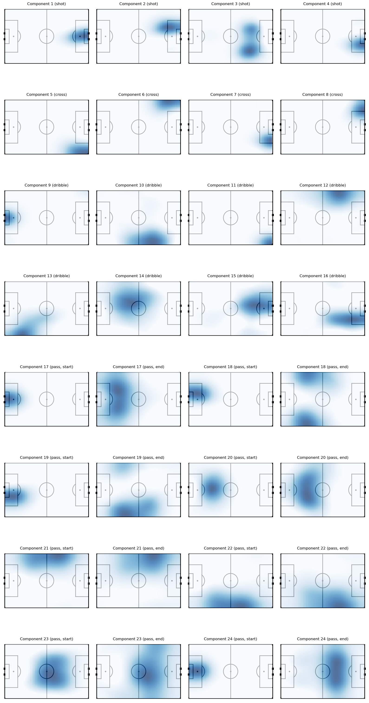
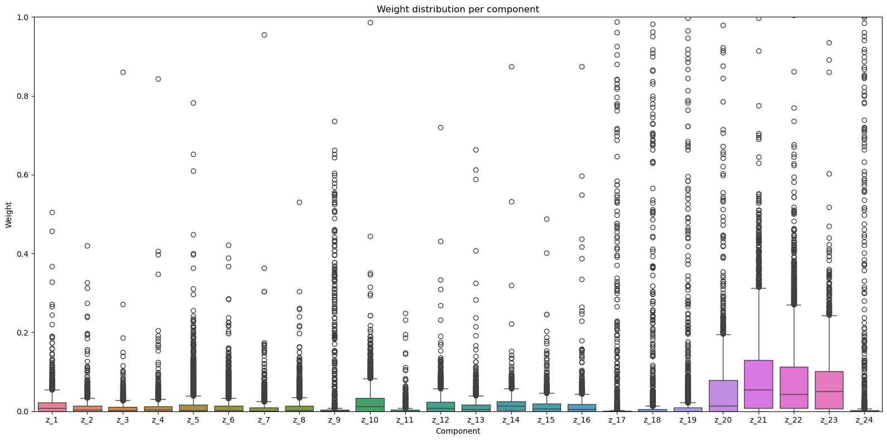
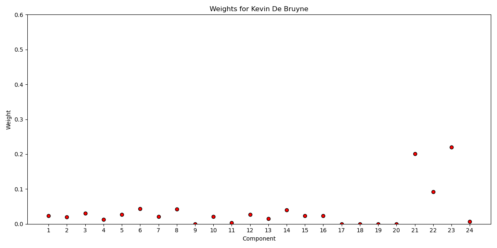
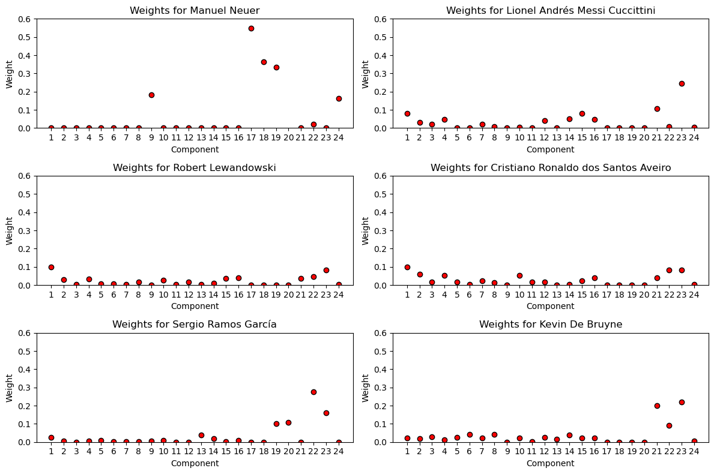
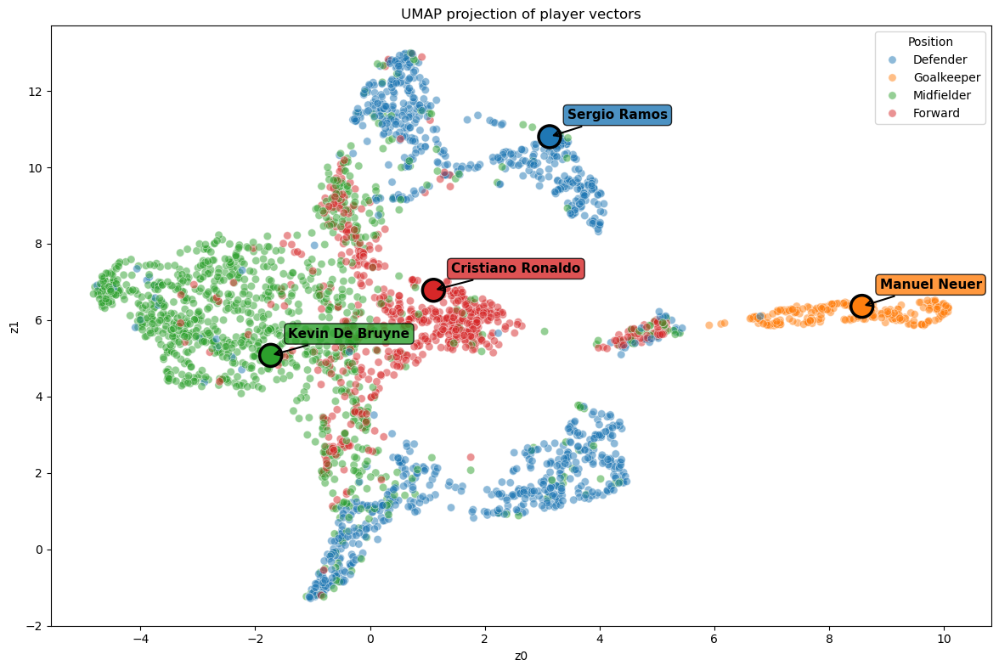

# Player Vectors

* Implementation of [Player Vectors: Characterizing Soccer Players Playing Style from Match Event Streams](https://ecmlpkdd2019.org/downloads/paper/701.pdf) in python.

* You may read more about the algorithmic details of player vecotrs on my blog post [Player Vectors: Implementation and Empirical Analysis](https://raphaelsenn.github.io/posts/2026/07/implementing-player-vectors/)

## Install

Clone the repository and install the package:

```bash
git clone https://github.com/raphaelsenn/playervectors.git
cd playervectors
pip install .
```

## Usage

## Expected Format for `df_events` (SPADL Format)

The `df_events` DataFrame used in `PlayerVectors.fit()` should follow the **SPADL format**. By default these columns are expected:

| Key | Default column | Description |
|-----|----------------|------------|
| **player_id** | `player_id` | Unique identifier for the player. |
| **action_type** | `type_name` | Type of action (e.g., shot, pass, cross, dribble). |
| **x_start** | `start_x` | X-coordinate where the action starts. |
| **y_start** | `start_y` | Y-coordinate where the action starts. |
| **x_end** | `end_x` | X-coordinate where the action ends (only needed with `with_end_coordinates`). |
| **y_end** | `end_y` | Y-coordinate where the action ends (only needed with `with_end_coordinates`). |

You may read more about the **SPADL format** [here](https://socceraction.readthedocs.io/en/latest/documentation/spadl/spadl.html).

If your columns are named differently, pass a mapping (only the keys you need) to `PlayerVectors.fit(column_names=new_column_names)`:

```python
new_column_names = {
    'player_id': 'your_player_id',
    'action_type': 'your_action_type',
    'x_start': 'your_x_start',
    'y_start': 'your_y_start',
    'x_end': 'your_x_end',
    'y_end': 'your_y_end'
}
```

### Fitting Player Vectors

Building **24**-component **PlayerVectors** with selected actions **shot**, **cross**, **dribble** and **pass** with respective components **4**, **4**, **8** and **8**.

```python
from playervectors import PlayerVectors


pvs = PlayerVectors(
    grid=(50, 50),
    sigma=5.0,
    actions=["shot", "cross", "dribble", "pass"],
    components=[4, 4, 8, 8],
    with_end_coordinates=[False, False, False, True],
)

pvs.fit(
    df_events=df_events,            # Event stream data in SPADL-Format. 
    minutes_played=pid_to_minutes,  # Maps player_id to the total minutes played across all events
    player_names=pid_to_name,       # Maps player_id to player_name. 
    verbose=True,
)

pvs.to_frame()               # all player vectors as a DataFrame
```

### Plotting Principle Components

```python
import matplotlib.pyplot as plt
from playervectors.visualize import plot_principal_components


plot_principal_components(pvs)
plt.show()
```


<p style="font-size: 12px; text-align: center;">
    <em>Output of: plot_principal_components(pvs)</em>
</p>


### Plotting Weight Distribution

```python
import matplotlib.pyplot as plt
from playervectors.visualize import plot_weight_distribution


plot_weight_distribution(pvs)
plt.show()
```


<p style="font-size: 12px; text-align: center;">
    <em>Output of: plot_weight_distribution(pvs)</em>
</p>

### Plotting Weights of a Single Player

```python
import matplotlib.pyplot as plt
from playervectors.visualize import plot_player_weights


# wy_id of Kevin De Bruyne (Central midfielder)
plot_player_weights(pvs, player_id=38021)
plt.show()
```



<p style="font-size: 12px; text-align: center;">
    <em>Output of: plot_player_weights(pvs, player_id=38021)</em>
</p>

### Plotting Weights for Multiple Playres


```python
import matplotlib.pyplot as plt
from playervectors.visualize import plot_player_weights


selected_players = {
    14712: "Manuel Neuer",        # goalkeeper
    3359: "Lionel Messi",         # forward
    14817: "Robert Lewandowski",  # centre forward
    3322: "Cristiano Ronaldo",    # centre forward
    3306: "Sergio Ramos",         # centre back
    38021: "Kevin De Bruyne",     # central midfielder
}

fig, axes = plt.subplots(nrows=3, ncols=2, figsize=(12, 8))
for ax, player_id in zip(axes.flat, selected_players):
    plot_player_weights(pvs, player_id=player_id, ax=ax)
plt.show()
```



<p style="font-size: 12px; text-align: center;">
    <em>Output of: plot_player_weights(pvs, player_id=player_id, ax=ax) for the selected players</em>
</p>

### Embedd Player Vectors using UMAP

```python
import numpy as np
import pandas as pd
import umap


# Only keep players whose position is known (this also drops the placeholder player_id 0).
player_ids = [pid for pid in pvs.player_vectors_ if pid in pid_to_position]
X = np.array([pvs.player_vectors_[pid] for pid in player_ids])

reducer = umap.UMAP(n_neighbors=15, metric="manhattan", random_state=42)
embedding = reducer.fit_transform(X)

position_names = {"GK": "Goalkeeper", "DF": "Defender", "MD": "Midfielder", "FW": "Forward"}
df_embedding = pd.DataFrame({
    "player_id": player_ids,
    "z0": embedding[:, 0],
    "z1": embedding[:, 1],
    "Position": [position_names.get(pid_to_position[pid], "Unknown") for pid in player_ids],
})
```

```python
import seaborn as sns
import matplotlib.pyplot as plt


highlighted = [14712, 3322, 3306, 38021]  # Neuer, Ronaldo, Ramos, De Bruyne

positions = df_embedding["Position"].unique()
palette = dict(zip(positions, sns.color_palette("tab10", len(positions))))

fig, ax = plt.subplots(figsize=(12, 8))
sns.scatterplot(data=df_embedding, x="z0", y="z1", hue="Position", palette=palette, alpha=0.5, s=45, ax=ax)

# Highlight the selected players: bigger dots in their position colour, with a label.
df_highlighted = df_embedding[df_embedding["player_id"].isin(highlighted)]
ax.scatter(
    df_highlighted["z0"],
    df_highlighted["z1"],
    s=350,
    c=[palette[position] for position in df_highlighted["Position"]],
    edgecolor="black",
    linewidth=2.5,
    zorder=5,
)
for _, row in df_highlighted.iterrows():
    ax.annotate(
        selected_players[row["player_id"]],
        xy=(row["z0"], row["z1"]),
        xytext=(15, 15),
        textcoords="offset points",
        fontsize=11,
        fontweight="bold",
        arrowprops=dict(arrowstyle="->", linewidth=1.5, color="black"),
        bbox=dict(boxstyle="round,pad=0.3", facecolor=palette[row["Position"]], alpha=0.8),
        zorder=6,
    )

ax.set_title("UMAP projection of player vectors")
plt.tight_layout()
plt.show()
```



<p style="font-size: 12px; text-align: center;">
    <em>UMAP projection of all player vectors, coloured by position</em>
</p>


## Running `demo.ipynb`

#### 1. Download this [Dataset](https://www.kaggle.com/datasets/aleespinosa/soccer-match-event-dataset) on Kaggle

#### 2. Create a folder named `data` in this Repository

```bash
mkdir data
```

#### 3. Copy all .csv files from the Dataset in the folder `data`

#### 4. Run notebook `demo.ipynb`

## About the Datasets

This dataset contains European football team stats.
Only teams of Premier League, Ligue 1, Bundesliga, Serie A and La Liga are listed.

All the credit is to Luca Pappalardo and Emmanuele Massucco.

[https://www.kaggle.com/datasets/aleespinosa/soccer-match-event-dataset](https://www.kaggle.com/datasets/aleespinosa/soccer-match-event-dataset)

## Citations

```bibtex
@article{ecmlpkdd2019,
  title     = {Player Vectors: Characterizing Soccer Players’
Playing Style from Match Event Streams},
  author    = {Tom Decroos, Jesse Davis},
  journal   = {ecmlpkdd2019},
  year      = {2019},
}
```